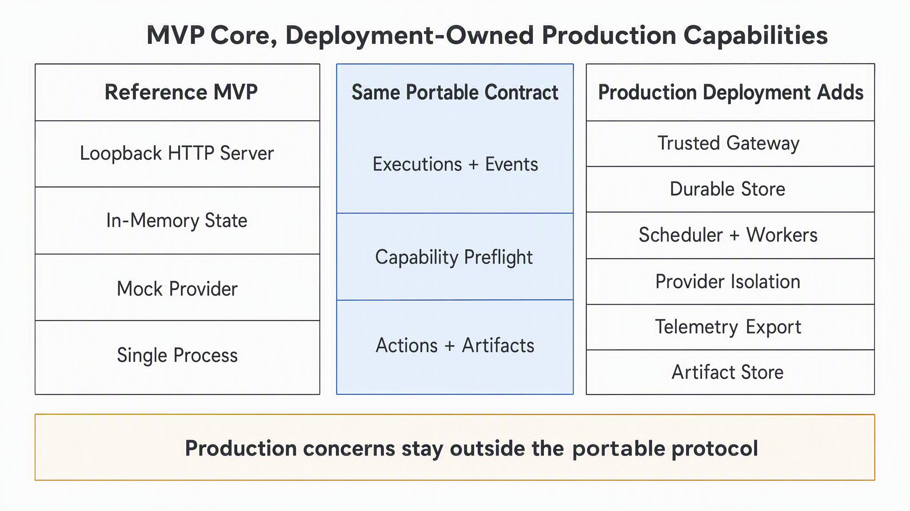

# Production Deployment Boundary

Status: deployment guidance

Protocol version: `2026-09-02`

The bundled server demonstrates protocol behavior. It is not a production control plane. A
production deployment can retain the same portable contract while adding reliability and security
outside the core package.

## Reference MVP

- binds HTTP to loopback by default;
- stores conversations, executions, events, actions, and Artifact descriptors in memory;
- runs in one process;
- registers only the deterministic Mock Provider in the bundled CLI;
- has no authentication or tenant isolation.

## Production Deployment Adds

| Concern | Deployment responsibility |
| --- | --- |
| Trusted gateway | Authenticate callers, authorize operations, apply tenant and network policy |
| Durable store | Persist portable state, events, idempotency records, and pending Actions |
| Scheduler and workers | Claim work, bound concurrency, retry safely, and recover abandoned leases |
| Provider isolation | Separate workspaces, credentials, processes, sandboxes, and network access |
| Telemetry export | Emit structured logs, metrics, traces, and audit records with redaction |
| Artifact Store | Retain bytes, enforce integrity and access, and resolve opaque descriptors |

## Preserve the Contract

- Keep event sequence monotonic within each Execution.
- Append exactly one terminal event.
- Preserve idempotency across retries and worker handoff.
- Persist Action correlation before exposing `action.required`.
- Confirm cancellation after Provider cleanup policy is applied.
- Do not move tenant credentials or raw Artifact bytes into portable event payloads.

Authentication, persistence, scheduling, and observability may be implemented by different products.
They remain deployment concerns so the portable protocol does not depend on one cloud or
proprietary platform.

## Security Acceptance

Treat reference-runtime tests as protocol evidence, not production security approval. Before using
real sensitive data or multiple users, verify these controls with synthetic data:

1. An unauthenticated caller cannot read or mutate any Execution or subscribe to its events.
2. One authenticated actor cannot access another actor's Conversation, Execution, pending Action,
   event stream, or Artifact descriptor. Knowing an ID must not bypass ownership checks.
3. Provider errors and native event fields pass the deployment's redaction policy before log/export.
4. Request size, concurrency, retained state, and event volume have enforceable quotas and cleanup.
5. Native processes cannot access another workspace or unapproved host files/network destinations.

The reference implementation intentionally does not supply these controls. In particular, a
loopback listener is not tenant authentication, an environment allowlist is not an OS sandbox,
and disabling ACP client file/terminal methods does not constrain the native process's own access.
